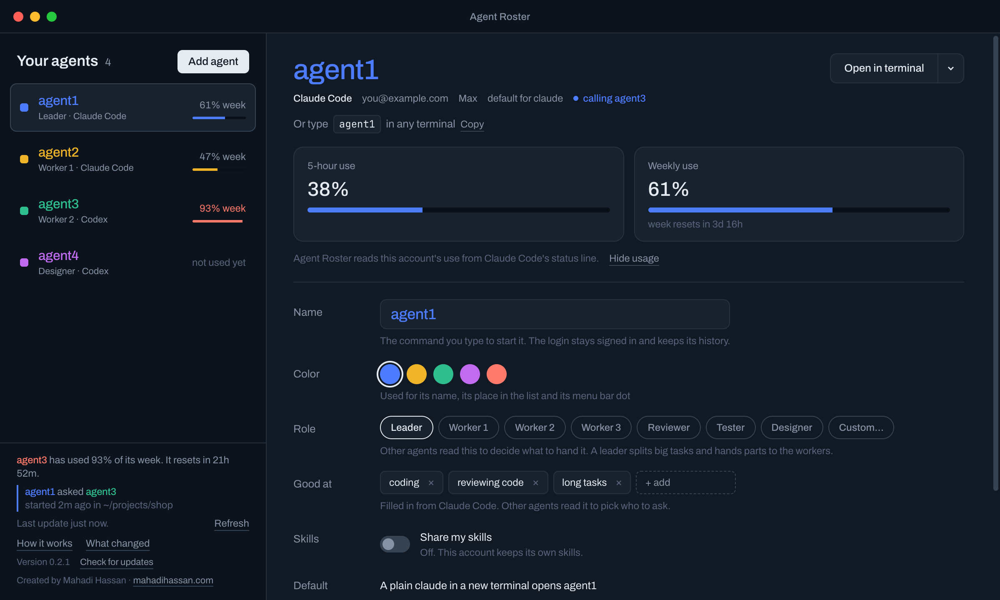
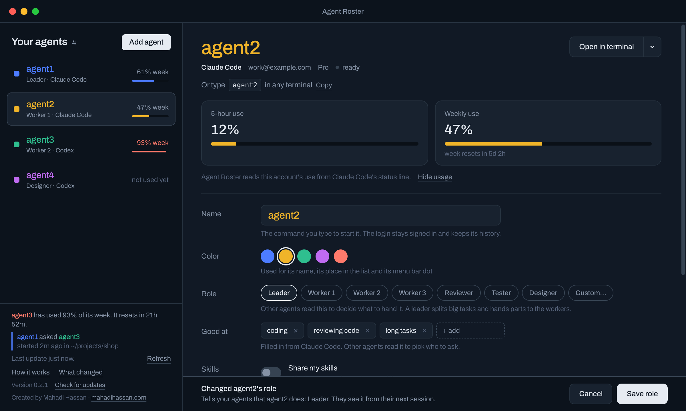
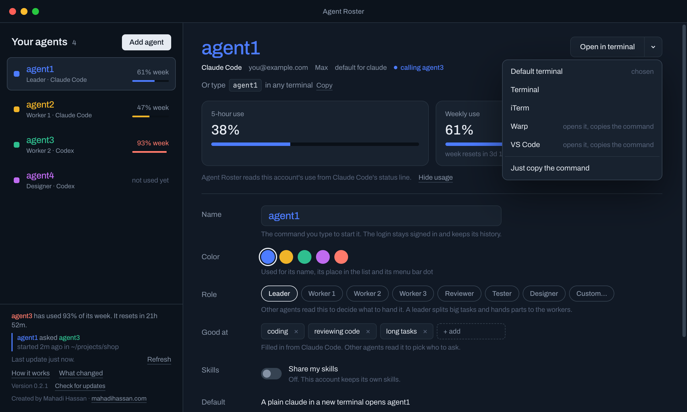
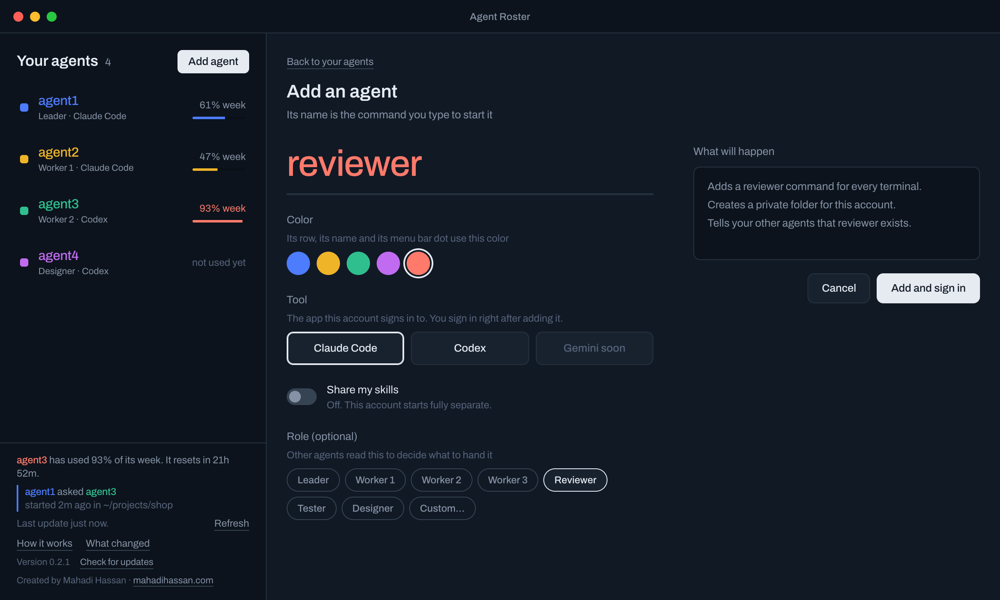
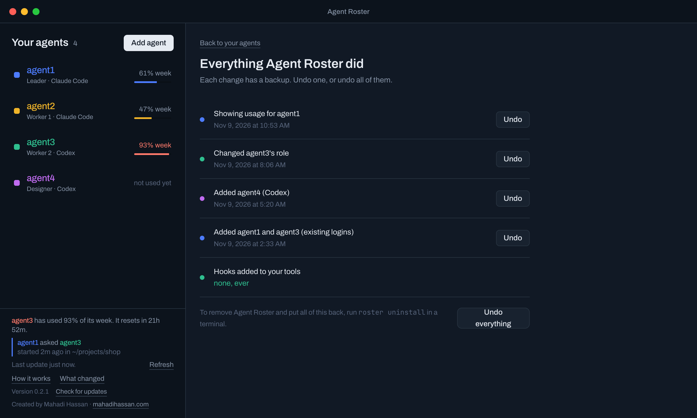
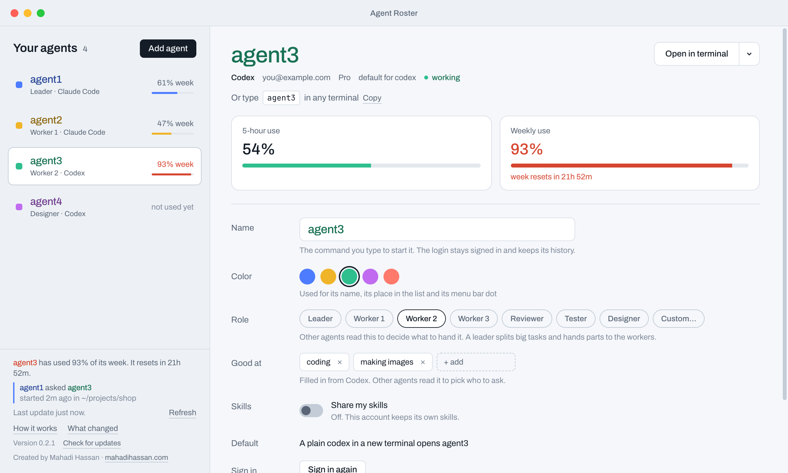

<h1 align="center">Agent Roster</h1>

<p align="center">
  <b>Name each of your Claude Code and Codex accounts, start any of them from any terminal,<br>
  see every account's limits in one window, and let your agents hand work to each other.</b>
</p>

<p align="center">
  <a href="https://github.com/itsmahadi007/agent-roster/releases/latest"></a>
  
  <a href="LICENSE"></a>
  
</p>

<p align="center">
  
</p>

## Why

If you pay for more than one Claude Code or Codex account, you know the routine: one runs out of
its weekly limit mid-task, you sign out, sign in as the other one, and lose your place. Agent Roster
gives every account a name, like `agent1`, `agent2` or `reviewer`. Type that name in any terminal
and you're in, signed in as that account, in the folder you're in. All of them stay signed in at
the same time, each with its own history and limits.

The agents also know about each other. Inside a session, say "ask agent3 to write the tests" and
your agent hands the job to agent3, on agent3's own account.

## Install

**Mac or Linux.** Paste this in Terminal:

```sh
curl -fsSL https://raw.githubusercontent.com/itsmahadi007/agent-roster/main/install.sh | sh
```

**Windows.** Paste this in PowerShell:

```powershell
irm https://raw.githubusercontent.com/itsmahadi007/agent-roster/main/install.ps1 | iex
```

The command picks the right build for your computer, installs the app and the `roster` command,
and opens Agent Roster. Run it again any time to reinstall.

**Or download it yourself** from the [latest release](https://github.com/itsmahadi007/agent-roster/releases/latest):

| Your computer | File |
|---|---|
| Mac with Apple chip (M1 and later) | `Agent-Roster-mac-apple-silicon.dmg` |
| Mac with Intel chip | `Agent-Roster-mac-intel.dmg` |
| Windows (most PCs) | `Agent-Roster-windows-x64-setup.exe` |
| Windows on ARM | `Agent-Roster-windows-arm64-setup.exe` |
| Linux, any distribution | `Agent-Roster-linux-x64.AppImage` |
| Linux, Ubuntu or Debian | `Agent-Roster-linux-x64.deb` |

The apps aren't signed by Apple or Microsoft yet. The first time you open a downloaded copy:

- **Mac:** System Settings > Privacy & Security > **Open Anyway**.
- **Windows:** **More info** > **Run anyway**.

The install commands skip this step.

You need [Claude Code](https://claude.com/claude-code) or [Codex](https://github.com/openai/codex)
installed. Agent Roster finds the logins you already have the first time it opens.

## Start in a minute

1. **Open Agent Roster.** It finds your existing Claude Code and Codex logins and offers to name
   them, like `agent1` and `agent3`. Nothing changes until you click Continue.
2. **Add your other accounts.** Click **Add agent**, give it a name, pick Claude Code or Codex,
   and sign in once.
3. **Use them.** Open a new terminal and type a name:

   ```sh
   agent1          # Claude Code, signed in as your first account
   agent3          # Codex, signed in as another one
   ```

## What it looks like

### Every account on one page

The list on the left shows each agent's role and weekly use, turning red past 90%. Click an agent
to open its page: 5-hour and weekly use with reset times, how to start it, and all its settings.
Calls between agents and limit warnings show at the bottom of the list.

### Change anything, see it first

Rename an agent, recolor it, pick a ready-made role like **Leader** or **Worker 1**, edit what it's
good at, share your skills with it, or make it the default `claude` or `codex`. Every change waits
in a bar at the bottom that says exactly what will happen. Nothing is written until you save.

<p align="center"></p>

### Open it in the terminal you use

Start an agent in your default terminal, or pick Terminal, iTerm, Warp, VS Code or any other
terminal found on your computer. Apps that can't take a command get it copied for you to paste.
You can always just type the agent's name.

<p align="center"></p>

### Add an account in seconds

<p align="center"></p>

### Every change can be undone

**What changed** lists everything Agent Roster ever did, each with a backup. Undo one change, or
all of them at once.

<p align="center"></p>

### Light and dark

The window follows your system setting.

<p align="center"></p>

## How agents work together

Every agent reads a short note Agent Roster keeps in its `CLAUDE.md` or `AGENTS.md`. The note lists
the other agents, their tool, their role and what they're good at:

| Name | Tool | Role | Good at |
|---|---|---|---|
| agent1 | Claude Code | Leader | coding, reviewing code, long tasks |
| agent3 | Codex | Worker 2 | coding, making images |

So when you tell agent1 "ask agent3 to make the icons", agent1 runs `agent3 exec "…"` on agent3's
account and brings back the result. A **Leader** splits big tasks and hands parts to the workers.
While a call runs, it shows in the window.

## From the terminal

Everything in the window also works as a command:

```sh
roster                       # every agent, its status and limits
roster add reviewer --codex  # add an account
roster rename agent2 writer  # rename (the login stays signed in)
roster role agent1 Leader    # set a role
roster good-at agent3 coding "making images"
roster default agent2        # a plain `claude` now opens agent2
roster limits enable agent1  # show a Claude Code account's usage
roster changes               # everything Agent Roster did
roster undo --last           # undo the last change
roster doctor                # check the setup
roster ui                    # open the window
```

Run `roster --help` for the full list.

## Safe by design

- **Nothing changes without a preview.** Every change shows exactly what it will do, runs as one
  step, and can be undone.
- **No hooks.** Agent Roster never installs hooks into Claude Code or Codex.
- **Your logins stay yours.** Agent Roster never reads password or token files. Signing in always
  uses the tool's own sign-in.
- **Your existing setup is kept.** Your original `~/.claude` and `~/.codex` stay where they are.
  Removing an agent keeps its login folder unless you ask otherwise.
- **Easy to leave.** `roster uninstall` undoes every change Agent Roster made.

## Updates

Agent Roster checks GitHub for a new version when it starts and every few hours. When one is out,
it offers **Update now**: it installs the new version and restarts, and your agents and settings
stay as they are. The version you have is shown at the bottom of the list.

## Questions

**An agent shows no usage.** Claude Code and Codex record usage while they run, so an agent you
haven't used yet has no numbers. Start it and send one message. For a Claude Code agent, click
**Show usage** once on its page.

**A new name isn't found in my terminal.** Open a new terminal window. Old windows still have the
old command list.

**"roster command wasn't found".** Move Agent Roster to your Applications folder and open it from
there, not from the downloaded disk image.

## Build from source

You need Rust (stable) and Node.js 24.

```sh
git clone https://github.com/itsmahadi007/agent-roster.git
cd agent-roster
cargo build --release -p agent-roster          # the roster command
cd app && npm ci && cargo tauri build          # the app
```

Run the checks with `cargo test --workspace` and `cd app && npm test`.

The design is in `docs/superpowers/specs/`.

## License

MIT. See [LICENSE](LICENSE).

---

<p align="center">Created by Mahadi Hassan · <a href="https://mahadihassan.com">mahadihassan.com</a></p>
